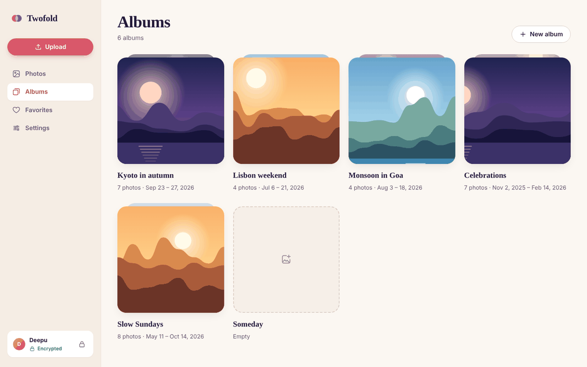
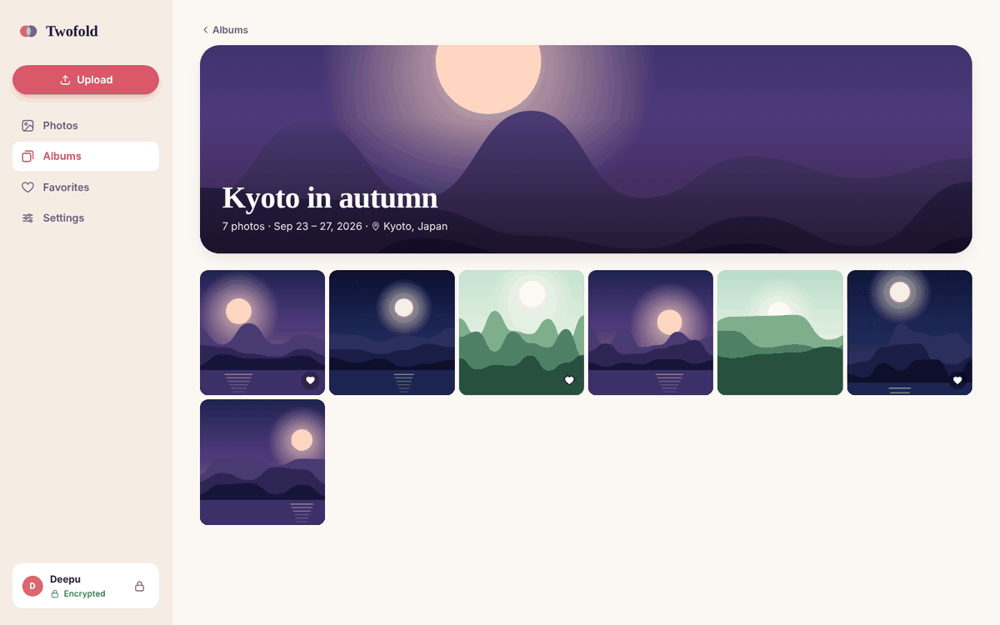
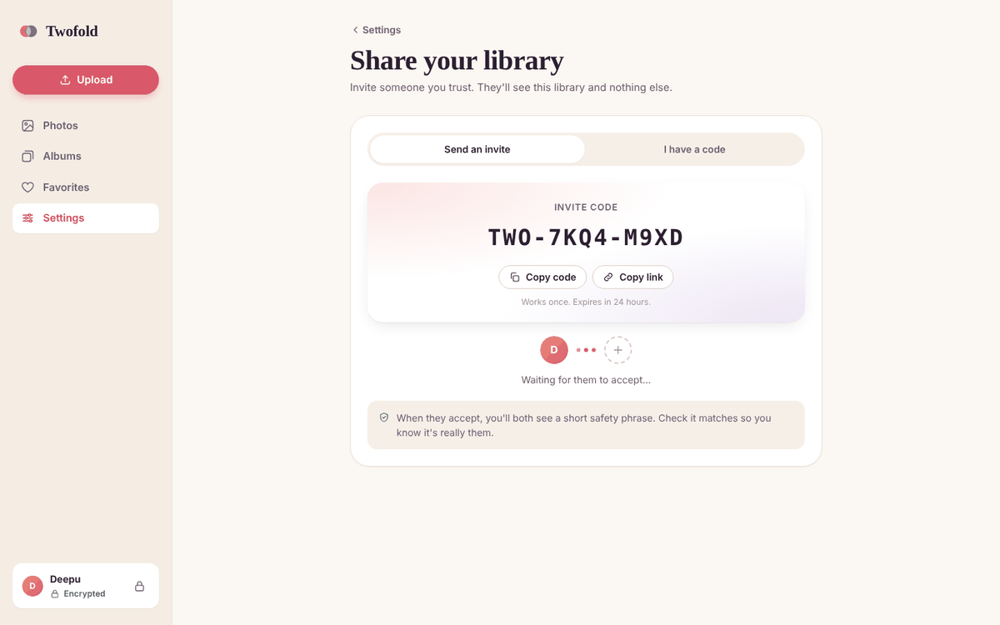

# Web UI

Accounts and photo storage are real: sign-up, log in, unlock, recovery and both passwords
call the API and `packages/crypto`, and photos, favorites and albums are stored end-to-end
encrypted in each space (design in [security.md](security.md)). Unlocking downloads and
decrypts the open space; locking or reloading drops everything decrypted. The mock library in `apps/web/src/mock/` (placeholder landscape
"photos" drawn as SVG data URIs) now only decorates the welcome and sign-in screens and
feeds unit tests. Sharing and invite codes are real too, and so is auto-lock.

Arcafold presents itself as a private, end-to-end encrypted photo library for anyone. Sharing
exists but is low-key (Settings → Sharing).

## Two passwords, two spaces

- The **main password** opens the main library: everyday uploads and backups.
- An optional **private password** opens a separate **private space** with its own photos
  and albums. It is set up from Settings → Passwords.
- Log in and Unlock have a single password box; the password typed decides which space
  opens. Nothing on those screens differs between the two.
- The main library never reveals whether a private space exists: Settings always offers
  "Set up", and the move dialog gives the same answer for a wrong password and for no
  private space.
- Inside the private space the app is re-tinted violet (`data-space="private"` on `<html>`,
  tokens in `styles/base.css`) and shows a small "Private" label, so you know where you are.
- **Move to private space** (photo viewer, main library) asks for the private password the
  first time after unlocking, then moves straight in until Arcafold locks. Right after
  setting up a private space it doesn't ask at all.
  **Move to library** (private space) works the same way with the main password. Albums
  belong to one space, so a moved photo arrives unfiled. A move re-encrypts the photo
  under a new key and id in the other space, then deletes the original.
- Each space is shared separately (Settings → Sharing → Invite). Sharing the library never
  shares the private space; private photos can only be shared from inside it, and the Share
  screen says so. The Share screen first asks **What can they do?**: **View only** (see and
  download, the default) or **Add and edit** (also add photos, favorite, organize albums and
  delete photos). The choice is kept in the invite and can be changed until it's confirmed,
  and later in Settings. Then it gives a link (**Copy link**, and **Share link** where the
  browser can share) and a code to type instead. They can accept any time in the next 7
  days; leaving the screen doesn't cancel anything. Invites still waiting are listed on the
  Share screen and in the album's people list, with **Cancel**.
- Codes are typed on their own screen, **Enter an invite code** (`/join`), reached from
  Settings → Shared with you → **Enter code**, from Albums → Shared with me, and from the
  Share screen. It also takes a whole pasted invite link, and refuses your own invite.
- Opening a link (`/join/<token>`) asks to sign in, sign up or unlock first, then comes back
  to it. It doesn't say who sent it until they reveal it: **Accept** sends this side's key,
  and the page says what's happening next, with **Don't join**. Either person can leave at
  any point; each step is taken the next time their side opens Arcafold (on load, when the
  app comes back into view after at least half a minute, and every few seconds while
  someone is partway through).
- When someone has accepted, the inviter sees "<name> wants to join <your library or the
  album>. Check these 4 words with them" at the top of every screen of that space, on any of
  their devices, with **They match, share** and **Cancel**. The person joining sees the same
  four words and "Waiting for <name> to confirm". Nothing is shared until the inviter
  confirms; what was shared turns up on the joiner's next visit.
- A library you join appears inside the space you joined it from, mixed in with your own
  photos, each tile marked with a small "shared" badge and the owner's name (icon only on
  phones), and its albums marked **Shared with you**. When the timeline has shared photos,
  Photos offers **All**, **Mine** and **Shared with me**. With **Add and edit**, photos
  uploaded into one of its albums go to that library under your name, and its photos can be
  favorited or deleted for everyone. With **View only**, its photos and albums only offer
  **Download**, and uploads always go to your own library. Either way they can't be moved
  to the other space.
- Settings → Sharing says how many people the open space is shared with, and lists each
  with what they can do (a **View only** / **Add and edit** picker that applies at once) and
  **Stop**; the summary line names everyone with their permission. Settings → Shared with
  you lists the libraries it joined, with what you can do there and **Leave**, and **Enter
  code**. A library or album whose owner stopped sharing it drops out of the list (and the
  vault) by itself the next time either loads.
- One album can be shared instead of a whole library: **Share** in an album's menu lists
  who has access (with **Remove**, and **Stop sharing with everyone**) and offers **Invite
  someone**, which opens the same invite screen for just that album
  (`/settings/share?album=<id>`). The other person joins with the link or code as usual. They can
  view and download the album's photos, including ones added later, and leave it from its
  menu; they can't change anything, and its photos stay out of their timeline and
  favorites.
- The lock button (sidebar, or top bar on phones) forgets which space was open.

## Finding files

- The search box finds files as well as photos. A file matches when every word typed
  (leaving out filler like "the", "my" or "files") starts one of its words: its name's, its
  type's ("pdf", "document"), its category's ("receipts", "medical") or the up to 16 words
  kept from inside it when it was sorted. A plural finds the singular ("bills" finds
  "bill"). With a time typed too ("scans in October"), files added then that match the rest
  also show. Matching files show above the photo results, newest first, and open in the
  viewer. This runs on the device with nothing to download, so it works with Smart search
  off.

## Document photos

- Photos that look like documents (receipts, ID cards, printed or scanned paper, forms,
  screenshots, handwritten notes and whiteboards) show up in Files under a **Document
  photos** filter, grouped by month, and open in the photo viewer, which steps through them
  and closes back to Files. It's worked out from the search vectors Smart search already
  has on this device (`lib/file-sort/looks.ts`, `app/document-photos.ts`): nothing extra is
  downloaded, stored or sent, and it needs Smart search on.
- They stay in Photos too. Settings → Search → **Hide document photos from Photos** (per
  device, `arcafold.documentPhotos`) leaves them out of the timeline and the viewer's
  steps through it; albums, Favorites and search still show them.
- Smart search also looks at a PDF's drawn first page. A PDF its text couldn't sort (in
  Other, and not moved there by you) goes to Receipts and invoices, IDs and travel or Notes
  when its first page clearly looks like one. This isn't saved: moving it yourself is.
- How a picture is told apart: its vector is compared with 37 short descriptions (16 of
  documents, 21 of everyday photos, shipped as vectors in `lib/file-sort/look-prompts.ts`),
  CLIP-style, and the document ones need 80% of the share. Tuning and results are in
  `apps/web/scripts/document-looks/README.md`.

## Views

- Screens of photos (timeline, albums, Favorites, a person) have **View** buttons in the
  page header: **Grid** (square tiles, the default), **Compact grid** (smaller squares, five
  to a row on phones) and **Uncropped** (rows of even height with each photo in its own
  shape, kept between 1:3 and 3:1). One choice applies to every photo grid, including
  search results and Recently deleted.
- Files is grouped by month like the timeline, and has **List** (rows, the default) and
  **Grid** (tiles with a PDF's first page or the file's icon, the name and details below,
  and the menu in the corner).
- Each choice is kept per device, so a phone and a computer can each use their own.

## Selecting photos and album actions

- Every photo grid (timeline, album, favorites) lets photos be picked. With a mouse, each
  tile shows a check in its corner on hover; on touch screens, **Select** in the page header
  starts picking, and then a tap selects instead of opening. Each month in the timeline has
  **Select all** for that month, and the selection bar has **Select all** for the page.
  Escape or the × stops picking.
- The selection bar sits over the top of the page: **Add to album** (pick an album, or make
  one and add to it), **Remove from album** (inside an album), **Share**, **Download**,
  **Add to favorites** / **Remove from favorites**, **Move to private space** / **Move to
  library**, and **Delete**. Photos from an album shared with you only offer **Download**. Changes run a few photos at a time; afterwards only the photos that
  didn't go through stay selected, and a toast says how many did.
- Moving a selection asks for the other space's password exactly as moving one photo does
  (once per unlock, same answer for a wrong password as for no private space). Photos from
  a library shared with you are left out of a move, and can only go in that library's
  albums: the album picker only offers albums at least one selected photo can go in.
- **Share** means sharing with people inside Arcafold, always through an album: inside one of
  your albums it opens the invite for that album; elsewhere it asks which of your albums to
  put the photos in (albums already shared come first, or make a new one), then opens that
  album's invite. Everyone invited to an album sees the same album, so sharing with more
  people never makes copies.
- **Download** saves copies to the device. It downloads and decrypts the originals four at
  a time (up to 1 GB in all) and shows "Downloading 12 of 19" with a progress bar; then the
  button saves them. One photo is saved as it is. Several download as one zip
  (`Arcafold <yyyy-mm-dd>.zip`, stored without compression), except on a touch device that
  can share files, where **Save to device** opens the share sheet so they can go straight
  to the photo gallery. Copies are named by when they were taken (`2026-10-19 14.32.05.jpg`,
  with ` (2)` for photos from the same second), never after the space or album. The
  dialog says downloaded copies aren't encrypted. The download doesn't belong to the
  dialog (`app/downloader.ts`, provided by `app/downloads.tsx`): closing it leaves the
  download going, with a card next to the upload one ("Downloading 3 of 17", then "17
  photos ready to save"), and the card or downloading the same photos again opens it where
  it is, without decrypting anything twice. Downloading other photos while one is still
  going asks first. The browser asks before leaving mid-download, auto-lock waits for it,
  and locking drops it.
- Every album has a vertical "more" menu, always visible on its card in Albums and next to
  **Select** inside it. Your albums: **Share**, **Download**, **Rename** and **Delete
  album** (deleting keeps the photos). Albums of a library shared with you: **Download**,
  **Rename** and **Delete album** (only **Download** when it's shared view-only). An album shared with you: **Download** and **Leave
  album**. Inside an album there is also a **Download** button.
- Albums has three tabs: **All albums**, **Shared with me** (other people's albums, shared
  alone or with their library) and **Shared by me** (your albums shared with at least one
  person). Cards say who an album is from or shared with.
- **Files** holds everything that isn't a photo or a video (PDFs, documents,
  spreadsheets, text). The upload dialog has one **Choose photos or files** button; photos and
  files can be picked or dropped together, and anything that isn't a photo goes to Files; videos are refused ("Videos
  can't be added yet"). Files is a list, newest first, with a PDF's first page as its
  picture (or an icon for the kind of file, from its name and type), its size and its date (the
  file's own date from the device, or the upload time when the device gives none). Tapping a file opens it at `/files/:id`: a PDF page by page (a page at a time,
  with Previous and Next, on light phones), text and HTML as plain text, a Word document as
  its paragraphs, and anything else as "No preview for this kind of file" with a
  **Download** button, which every file has. Files are sorted on the device that adds them
  (while Smart search is on there) into Receipts and invoices, Bank and finance, Tax, IDs
  and travel, Medical, Work and contracts, School, Notes and Other; once there's more than
  one category, a row of filters (All, then each category with its count) sits above the
  list, and in All each row also says its category. Its menu has **Download**, **Add to album**,
  **Move to category** (nine choices; files like it go there from then on), **Move
  to private space** (or **Move to library**) and **Delete**, which sends it to Recently
  deleted like a photo. Files never appear in the timeline or People, and count against
  the same 1 GB.
- **Files in albums.** An album can hold files as well as photos (one "Lisbon" album with
  the photos and the booking PDF). Its page lists them under **Files**, below the photos,
  each with **Download** and **Remove from album**; a file opened there goes back to the
  album. Album cards, the album picker and the delete confirmation count both ("3 photos
  and 1 file"), and **Download** on an album includes its files. Uploading straight into an
  album files whatever is picked there. Sharing an album shares its files too, with the same
  rules as its photos: someone you shared it with sees them in the album only (never in their
  own Files) and can only download them; a library shared with **Add and edit** lets the
  other person put its files in its albums. The phone tab bar is Photos, Albums, Files, People and
  Settings; Favorites stays in the desktop sidebar and is a link at the bottom of Albums on
  phones.
- **Delete** (in the selection bar or the viewer) moves photos to **Recently deleted**: the
  toast has **Undo** for 6 seconds, and the confirmation says they can be restored for 30
  days. Recently deleted is linked at the bottom of Albums (All albums tab) and lives at
  `/recently-deleted`. A tap there selects (photos aren't opened); each tile shows how many
  days are left; the bar offers **Restore** and **Delete now**, and **Empty** deletes
  everything there for good. Deleted photos still count against storage. When it was
  deleted is sealed in the photo's record, so the device opening the space deletes for good
  whatever is past 30 days (`loadTrash` in `app/vault.tsx`); a space nobody opens keeps
  them until it is opened. View-only members never see it; members who can edit see and
  restore what's deleted in that library.
- Code: `app/selection.ts` (selection state), `components/SelectionBar.tsx`,
  `AlbumPicker.tsx`, `DownloadDialog.tsx`, `AlbumActions.tsx`, `AlbumShareDialog.tsx`,
  `MoveSpaceDialog.tsx` (shared with the viewer), and the vault's batch changes in
  `app/vault.tsx`.

Unlocking tries the password against every key slot on the device (see
[security.md](security.md#key-slots)), so the server never learns which space opened.
Setting up a private space from the main library always looks the same and replaces any
private space that already exists, since the main library can't know whether there is one.

## People

After sign-up (and once at the next unlock for accounts made earlier) a "Smart features, on
your device" dialog asks whether to turn face grouping on, with two buttons, "Turn on" and
"Not now" (`components/SmartFeaturesPrompt.tsx`). Closing it without choosing asks again
later. The answer is saved on the account, so the account's other devices start the same
way; each device can still turn it on or off from the People page or Settings → People, and
that choice wins on that device (`lib/people/face-setting.ts`). Download text says
"resources", never models. Once on, the device downloads what it needs (about 14 MB, once)
and looks at every photo's preview in the background, 12 at a time
(`app/people.tsx`, `lib/people/face-scan.ts`). It pauses while photos upload or the tab is
hidden, saves what it found every 48 photos, and picks up new photos as they arrive. The
page title says how far it has got ("120 of 900 photos looked at").

Faces are grouped on the device (`@arcafold/core/people/grouping`): a face joins a named person
when it looks enough like them, and the rest are clustered. A group shows once someone is
in at least 3 photos. Each card shows a crop of the face (`components/FaceThumb.tsx`).
On a person's page you can add a name or rename, merge with someone else, hide them from
People (and show them again), say "This is me" (only one person can be, so marking someone
else moves it), give them labels (Friends, Family, Work), and select photos to take out with "Not this person", which
the grouping then remembers. The photo viewer opened from a person steps through only
their photos. "You" and labels show before the photo count on the card and the page.

Settings → People turns it off on this device (what was found stays, encrypted) or
deletes all face data for the open space.

## Smart search

Smart search is on by default on every device (`app/search.tsx`). Once there's a photo to
look at, after face grouping has had its turn, the device downloads its resources (about
89 MB, once) and works out each photo's search vector in the background, pausing while
photos upload or the tab is hidden. A computer looks at every photo; a phone looks only at
the photos it uploads, and waits for Wi-Fi before downloading unless the person taps
"Download now". A small card in the status corner (`components/SmartSearchCard.tsx`) shows
the download with a Pause button, the Wi-Fi wait, or what went wrong with "Try again";
nothing shows while photos are looked at. Text says "resources", never models.

Settings → Search shows how far it has got ("120 of 900 photos ready to search"), turns it
off on this device, or deletes all search data for the open space.

## Search

The search box sits at the top of every signed-in screen (`components/SearchBar.tsx`, in
the app shell), so there's no Search tab. "/" jumps to it, and on phones the magnifier in
the top bar does too. Searching from any screen opens the results at `/search`; the URL
never holds what was typed. A search is read by a small parser (`@arcafold/core/search/query`) into who, when and what:

- **Who**: names from People, "me"/"my" (whoever is marked "This is me"), "us"/"we" (me and
  at least one other person) and "friends", "family" or "work" when someone has that label.
  Typing "me" with nobody marked shows a note pointing to People.
- **When**: a year, a month ("in December", any year), a month and year, today, yesterday,
  and this or last week, month or year.
- **Taught words**: names taught to search (below), which find photos that look like the
  photos they were taught with.
- **What**: everything else, minus words like "photos", ranked by Smart search.

Who and when filter the open space's photos; what ranks them (`@arcafold/core/search/find`). Each
part shows as a chip; tapping one off searches again without it, and its words go back to
being words. Results come as best matches, with "Show N more" for weaker ones. Opening a
result steps through the results; closing comes back to the same search.

The first search with words downloads the text half (about 65 MB, once), with a progress
line that says "resources". Once it's loaded on a quick device, results follow the typing;
otherwise they come on Enter. With Smart search off, people and dates still work and words
explain how to turn it on. The query is never put in the URL or saved; locking forgets it.

**More like this** (the magnifier in the photo viewer, while Smart search is on) starts a
new search for photos that look like that one, shown as a "Like this photo" chip; words
typed after it narrow it down. **Teach a word** (in the selection bar, for 3 to 5 photos)
names what the photos show, like a pet or a place; typing that name then finds photos that
look like them. A name can't be a person's or another word's. Settings → Search lists the
words, each with Forget. Looking alike is compared with its own tuning (`LOOKS_TUNING` in
`@arcafold/core/search/find`), since photos score much higher against photos than against words.
If the photos haven't been looked at yet, the search says so instead of showing nothing.

**Save as album** (under a search's chips, while Smart search is on) saves the search as a
smart album (`screens/SmartAlbum.tsx`, `/albums/smart/:id`). It keeps what was typed, the
chips tapped off, the "More like this" photo, the words' search vector and when it was
saved, so dates like "last year" keep meaning the year they meant then and opening it never
needs the text half. Each time it's shown, the search runs again over the photos looked at
so far (`useSmartAlbum` in `app/answer.ts`), so new photos that match appear on their own.
Smart albums show under All albums with a "Smart" badge, can be renamed or deleted (their
photos stay), and can't be shared. If a taught word or name it used changes, the album says
to save the search again.

## Accounts and locking

- Signed out: only the welcome, sign-up, log-in and recovery screens are reachable; library
  routes redirect to `/login`.
- Signed in but locked (after a reload, or the lock button): library routes redirect to
  `/unlock`, which greets the account by name. Keys are only ever in memory, so a reload
  always locks.
- Sign-up makes the keys and the recovery key at step 1 (Argon2id runs on the device, so
  the button shows "Creating your keys…"), shows the 12 words at step 2, and only then
  creates the account.
- `/signup/recovery-key` doubles as "New key" from Settings in the main library. The private
  space can't make a recovery key; its Settings say the private password can't be recovered.
- Password hashing runs in a Web Worker, so spinners keep moving and the page stays usable
  while a login or unlock works. Signing out in the meantime ("Use another account")
  cancels it: the library doesn't open afterwards.
- Auto-lock (Settings) locks after 1, 5 or 15 minutes without use (default 15), or only
  when the tab closes. Pointer, key, wheel, touch and scroll count as use; a hidden tab gets
  none, so its time counts as idle, and the check runs again when the tab is shown. Uploads
  in progress count as use, so a long upload isn't dropped, and the countdown restarts when
  they finish. The choice is a per-browser preference in localStorage
  (`arcafold.autoLockMinutes`); nothing secret is stored with it. Logic in
  `lib/idle-timer.ts` and `app/auto-lock.tsx`.
- Delete account asks for a password.
- Settings → You → Edit changes the name (shared by both spaces) and the profile photo
  (one per space, so the private space starts with initials). The photo is cropped to a
  square on the device and encrypted before upload (`app/profile.tsx`,
  `app/profile-photo.ts`, `components/ProfileDialog.tsx`).
- Storage used shows in Settings → Storage and at the bottom of the sidebar as "19.1 MB of
  1 GB used": the account's total across both spaces, the same in either one, against the
  one shared 1 GB (`app/storage.tsx`, `lib/storage-usage.ts`).
- State lives in `app/account.tsx` (who is signed in, which slot is open) and
  `@arcafold/core/account` (every operation that touches keys); `app/access.ts` decides
  redirects.

## Screens and routes

Routes are the same in both spaces; the content depends on which space is open.

| Route                  | Screen                                                             |
| ---------------------- | ------------------------------------------------------------------ |
| `/`                    | Landing page (prerendered)                                         |
| `/privacy`             | Privacy Policy (prerendered)                                       |
| `/terms`               | Terms of Use (prerendered)                                         |
| `/signup`              | Create your account (step 1 of 2)                                  |
| `/signup/recovery-key` | Save your 12-word recovery key (step 2)                            |
| `/login`               | Log in                                                             |
| `/unlock`              | Unlock (returning user, key not in memory)                         |
| `/recover`             | Reset the password with the recovery key                           |
| `/photos`              | Library or private space: timeline grouped by month                |
| `/photos/:id`          | Photo viewer; `?from=favorites`, `album:<id>` or `person:<id>`     |
| `/albums`              | Albums, with tabs and "New album"                                  |
| `/albums/:id`          | One album, with Download and its menu                              |
| `/favorites`           | Favorites                                                          |
| `/files`               | Files that aren't photos: download, move, delete                   |
| `/files/:id`           | One file: PDF, text or Word shown in the app, and Download         |
| `/recently-deleted`    | Recently deleted: restore, delete now, or empty                    |
| `/people`              | People found in photos (or turning face grouping on)               |
| `/people/:id`          | One person's photos: name, merge, hide, "Not this person"          |
| `/settings`            | Profile, passwords, sharing, security, devices, appearance         |
| `/settings/import`     | Import from Google Photos or Apple Photos (`?from=apple`)          |
| `/settings/share`      | Invite someone to the open space (or `?album=` one album), or join |
| `/join/:token`         | Someone's invite link: accept it                                   |
| `/join`                | Enter an invite code                                               |
| anything else          | Not found                                                          |

Upload is a dialog opened from the sidebar (desktop) or the top bar (phones); inside an
album it also adds the photos to that album. Each photo is read on the device, given a
640px JPEG preview (`lib/thumbnail.ts`, drawn in a Web Worker by `lib/thumbnailer.ts`),
dated, encrypted (also in a worker), then its two files are uploaded together. The date is
when the photo was taken, read from its own EXIF block (JPEG, HEIC, AVIF, WebP and PNG,
`lib/photo-date.ts`), with its time zone when the camera wrote one; a photo without one
takes the file's own date, and failing that, now. The date goes into the photo's sealed
metadata like everything else, so the server never sees it. Browsers other than Safari
can't decode HEIC, so for those the preview worker decodes it with libheif, compiled to
WebAssembly (`lib/heif.ts`, the `libheif-js` package, LGPL-3.0, unmodified). Its 1.4 MB of
WebAssembly is fetched the first time a HEIC photo needs it, photos over 50 megapixels are
refused rather than risk running out of memory, and the original is stored byte for byte
either way. The progress bar
follows those steps. Stored photos are held back and added to the library together when
the whole batch has finished, so the grid and the storage figure change once rather than
after every photo. Up to three photos go at once, in the order they were added, so each
one's server round trips overlap the others'. Big photos go fewer at a time: at most 48 MB
of originals are in flight, and a photo bigger than that goes alone (`lib/upload-queue.ts`),
which keeps memory in check on phones. The upload list shows that small preview once a photo
has been read, never the original, so dropping hundreds of photos stays light.

Uploads don't belong to the dialog: the queue (`app/uploader.ts`, provided by
`app/uploads.tsx`) lives as long as the open vault, so closing the dialog (the X, Close, a
click outside, Escape), moving around the app or switching browser tabs leaves photos
uploading. While they run with the dialog closed, a small card (bottom right on desktop,
under the top bar on phones) shows "3 of 6 photos uploaded" with an overall progress bar,
and clicking it reopens the list. "Cancel remaining" drops photos that haven't started.
Closing or reloading the tab can't keep uploading, so the browser asks before leaving while
uploads run; locking drops the queue with the vault. When everything has finished with the
dialog closed, the list starts over, unless a photo failed: then the card stays, saying how
many couldn't upload, until the list has been opened.

### Importing from Google Photos and Apple Photos

`/settings/import` brings a Google Photos or Apple Photos export into the open space (either
space). It is reached from three places, so it's easy to find on phones and computers alike:
a "Moving from Google or Apple Photos?" card under the drop area of the upload dialog (which
every screen opens, and which shows the import's progress while one runs), an "Import from
Google or Apple" button on the empty library, and Settings > Import (a row each for Google
Photos and Apple Photos; the Apple one opens `?from=apple`). Each of its two tabs puts the
quickest way first, and keeps a whole-library export, which also brings albums, behind a
"Moving everything, with albums?" fold:

- Google Photos: "Connect Google Photos" (`components/GooglePhotosConnect.tsx`). The person
  signs in with Google in a window of its own (`app/google-sign-in.ts`), taps "Choose photos
  in Google Photos" to pick up to 2,000 photos in Google Photos (its app on phones), and
  comes back; the page has been asking Google whether the picking is done
  (`lib/import/google-picker.ts`). The picked photos then go through the import below, each
  downloaded from Google straight into the browser, dated by Google's `createTime`. Albums
  don't come over this way, and videos are skipped. The finished pick is ended at Google.
  The button only shows when the deployment has a Google OAuth client
  (`VITE_GOOGLE_CLIENT_ID`, docs/deployment.md); without one the export steps show instead.
  The export: ask Google Takeout for Google Photos only, as .zip files.
- Apple Photos: Apple has no way in for other apps, so the quickest way is the phone's own
  photo picker: "Upload photos" opens the upload dialog, whose file picker on an iPhone or
  iPad offers the Photo Library. The export: ask privacy.apple.com for a copy of iCloud
  Photos (zips with Apple's records), or on a Mac, use Photos' File › Export › Export
  Unmodified Originals into a folder. A zip of photos downloaded from iCloud.com works too.

The person then picks every zip ("Choose zip files") or the folder ("Choose a folder").
Which kind of export it is comes from its files, not the tab (`lib/import/plan.ts`). The
export never leaves the device: `lib/zip-reader.ts` opens zips there, reading only each
zip's directory and then one photo at a time from the file on disk, so a 50 GB export
doesn't have to fit in memory.

`lib/import/takeout.ts` works out what's in the export from paths and sizes alone. Year
folders ("Photos from 2019", and the same in a few other languages) give each photo a year;
any other folder is an album, except Trash, Bin and Locked Folder, whose photos are never
imported. A photo in an album is also in its year folder, so photos are matched by name and
size and imported once, into every album they were in. Where Google kept an "-edited" copy,
that copy is imported instead of the original. Each photo's JSON "sidecar" is found even when
Google cut its name short or moved a "(1)", and says whether the photo was a favorite.
Videos are counted and skipped, since Arcafold can't store videos yet. In either kind of export
a clip next to a photo of the same name (a Live Photo's IMG_0001.MOV beside IMG_0001.HEIC) is
the photo's moving part: the still comes in and the clip is left out without being counted.

`lib/import/apple.ts` reads Apple's exports. A copy of iCloud Photos comes in parts ("iCloud
Photos Part 1 of 3"), each with a "Photo Details" CSV giving every photo's date (in GMT,
"Monday March 26,2018 9:12 PM GMT"), and whether it is a favorite, hidden or deleted, plus an
"Albums" folder with a CSV per album listing its photos by name. Deleted photos are never
imported. Hidden photos only go into the private space: importing into the library leaves
them out and says how many, and suggests importing them from the private space. A Mac export
or an iCloud.com zip has no records, so its photos have no year until they're imported and
dated by their EXIF (a file's own date is often when it was exported), and its folders aren't
treated as albums.

The screen then lists the export's years (or "All photos" when it has none) with their photo
counts and about how much each takes up once stored (`lib/import/selection.ts`), and ticks
the newest years that fit in the account's free space. Import stays off while the ticked
years don't fit. Starting makes the export's albums first (reusing an album of the same
title already in the space, so a second go doesn't make duplicates). The import then runs in
`app/importer.ts`, which `app/imports.tsx` provides for as long as the vault is open, so the
person can move around the app while it runs. Each photo is read from the zip, then
fingerprinted (see `docs/security.md`). A photo the space already has is skipped and only
added to its albums. Any other photo is given a preview and dated, using its own EXIF date
first, then the export's records (Google's `photoTakenTime`, Apple's
`originalCreationDate`), then the file's date. A photo the export marks as a favorite comes
in as a favorite. It is then encrypted and uploaded the same way as an upload, a few at a
time under the same limits as the upload queue. New photos are added to the library every 24
photos. A progress bar and a Stop button show while it runs. At the end, the screen says how
many photos were imported, how many were already there, and which couldn't be imported and
why. The browser asks before the tab is closed mid-import, imports count as use for auto-
lock, and locking drops the import. Starting the same export again skips everything already
brought in, so a stopped import can carry on.

The grid shows a quiet placeholder until a photo's preview has been downloaded and
decrypted. Previews are only asked for once their photo is near the screen (within about
two phone screens, `lib/near-screen.ts`), and are downloaded up to 48 per request.
Photos already on the screen go first, 12 per request, so they don't wait behind the ones
below the fold. Each preview is decrypted as soon as its bytes arrive, without waiting for
the rest of its request. When the vault opens, your own library, every library or album
shared with you, and who your albums are shared with are all fetched at the same time.
Each grid tile is memoized and only re-renders when its own photo (or its selection)
changes, so previews arriving don't redraw the whole grid; images ask for their previews
through a context of their own that never changes. Coming back to the tab checks the
session (and invites) at most every 30 seconds (`lib/when-visible.ts`), not on every
switch.
Decrypted previews reach the grid in batches, at most every 100 ms, so a large library
redraws a few times a second rather than once per photo. A request that fails is tried
again after 1, 2 and 4 seconds (`app/thumb-loader.ts`), so a dropped connection doesn't
leave tiles empty. The viewer then fetches and
decrypts the original. A HEIC original in a browser that can't show HEIC (all but Safari)
is shown through a JPEG copy, at most 4096 px on its longer side, made in the thumbnail
worker and kept in memory only while the photo is open; Download still saves the original.

The photo viewer zooms with the mouse wheel or a trackpad pinch (towards the pointer),
a two-finger pinch on touch screens, a double-click (toggles 2.5×), and the `+`, `-` and
`0` keys. A zoomed photo pans by dragging; a fitted one swipes to the next photo. After
each zoom change the level (as a percentage of the fitted size) shows at the top of the
photo for a moment, then fades. The maths is in `lib/zoom.ts`, the gestures in `screens/use-zoom.ts`.

## Landing page, legal pages and SEO

- The landing page (`screens/Welcome.tsx`) leads with privacy without overselling, and
  never presents Arcafold as a couples app. Its illustrations are small static copies of
  real screens drawn with the mock landscape art: the unlock box opening either the library
  or the private space, and an album shared with "Estrella" with the four-word check. Its
  FAQ (`site/faq.ts`) is honest about the trade-offs: no password reset, no recovery for the
  private space, 1 GB per account.
- The Privacy Policy and Terms of Use (`screens/Privacy.tsx`, `screens/Terms.tsx`) describe
  the real design. Details only the operator can give (legal name, contact email,
  jurisdiction, effective date) live in `legal/details.ts`; while any is
  missing the pages show highlighted placeholders and a draft notice. They still need a
  legal review before launch.
- The three public pages share a header and footer (`components/SiteChrome.tsx`) and are
  prerendered after `vite build` by `scripts/prerender.mjs`, using a server build of
  `src/prerender.tsx`. Each gets its title, description, canonical link, Open Graph and
  Twitter card tags, and JSON-LD (WebSite, WebApplication and FAQPage on the landing page),
  from `site/pages.ts` and `site/head.ts`. The build also writes `sitemap.xml` and
  `robots.txt`. `SITE_URL` sets the origin they use (see deployment.md).
- When the app loads, public pages render straight away instead of waiting for the
  account check, so the prerendered page doesn't flash blank; the landing page then sends
  an unlocked account on to its photos. App screens are served from `app.html`, marked
  `noindex`.
- Icons: `public/favicon.svg` (the logo mark, lighter in dark mode), `favicon.ico`,
  `apple-touch-icon.png`, `icon-192.png`, `icon-512.png`, `icon-maskable-512.png` (listed
  in `site.webmanifest`) and the 1200×630 link preview `og-image.png`. The PNGs and the
  .ico are rendered by `node scripts/render-images.mjs` (Playwright's Chromium and
  ImageMagick); rerun it after changing the logo.

## Structure (`apps/web/src`)

- `app/` — routing (`routes.ts` parses URLs, `router.tsx` is a small History API router
  with no dependency), and in-memory state: vault (the open space), theme, toasts.
  `space-store.ts` reads and writes one space's encrypted photos and albums through the
  API.
- `components/` — layout (`AppShell`, `AuthLayout`) and shared pieces (fields, dialog,
  photo grid, upload dialog, icons, logo).
- `screens/` — one file per screen, each with its own stylesheet.
- `styles/base.css` — design tokens, light and dark themes, the private-space tint, buttons
  and forms.

## Visual language

- Warm ivory with a rose-coral accent in light mode, deep plum in dark mode; cooler violet
  in the private space. The theme follows the device; Settings can force light or dark
  (kept in memory only).
- Serif headings (system serif stack) over a system sans body. No web fonts, so the CSP's
  `default-src 'self'` needs no exceptions.
- Plain CSS with custom properties; no CSS-in-JS and no `<style>` injection, so
  `style-src 'self'` holds. The only inline style is the upload progress width, set
  through the CSSOM, which the CSP allows.
- Layout switches at 860px: sidebar on wide screens, top bar plus bottom tabs on phones.

## Security notes

- Decrypted photos are shown through in-memory object URLs, revoked when the vault
  unmounts (lock, sign-out), and must never be written to `localStorage`, IndexedDB or
  caches.
- No password is kept anywhere: it is turned into keys inside `@arcafold/core/account` and
  dropped. Keys live only in React state and are dropped on lock, sign-out and reload,
  along with every decrypted photo (the vault provider is remounted).

## Screenshots

| Desktop                                                        | Desktop                                                       |
| -------------------------------------------------------------- | ------------------------------------------------------------- |
|                     |                     |
|                       |                      |
|                         |                      |
|                    |                  |
|                         |             |
|       |  |
|  |                                                               |

Phones:

