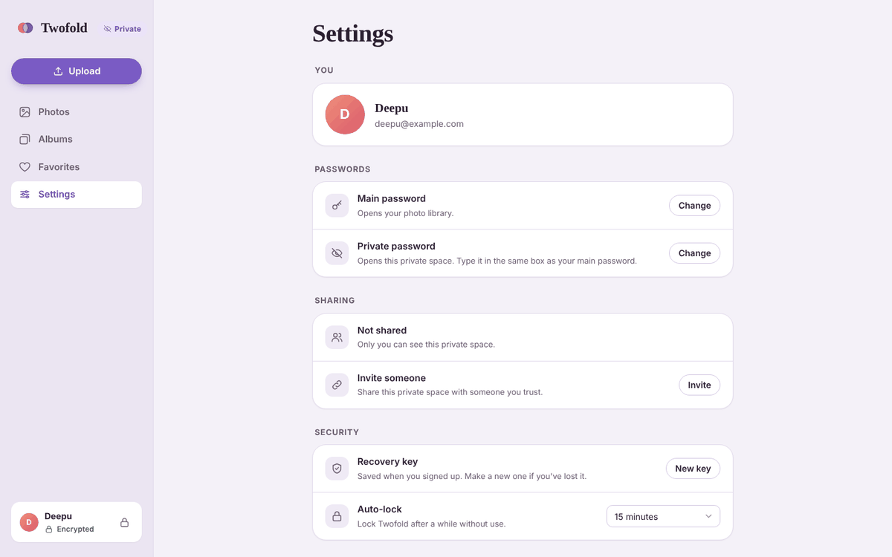
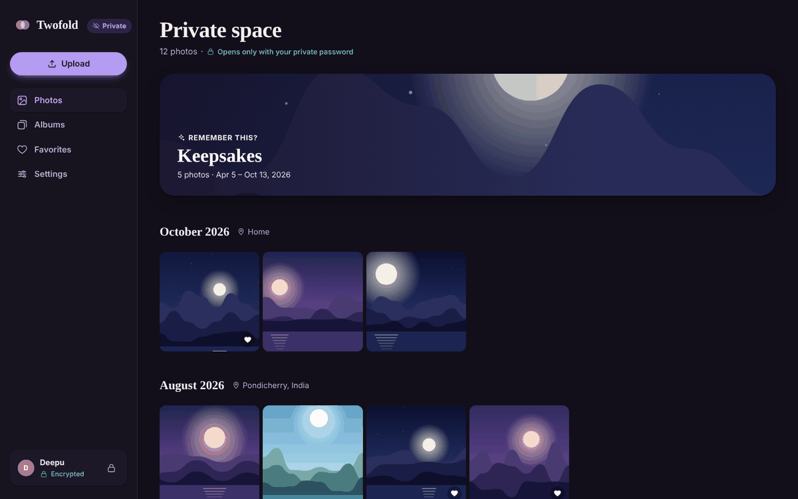
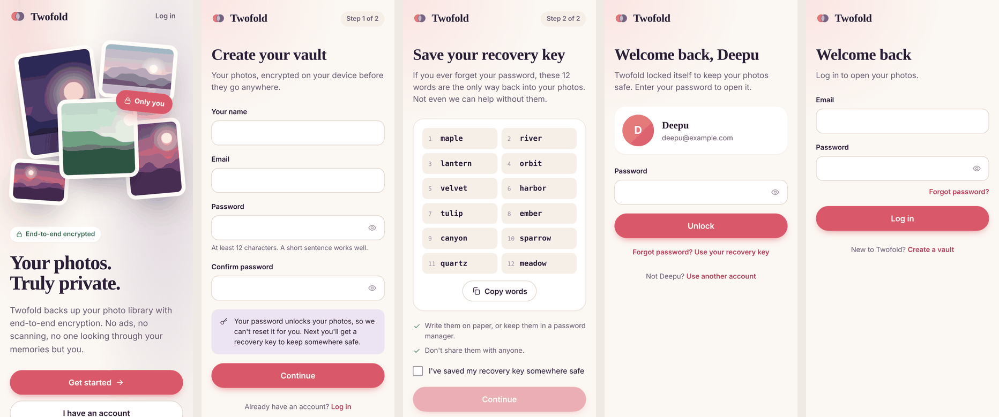

# Web UI

Accounts and photo storage are real: sign-up, log in, unlock, recovery and both passwords
call the API and `packages/crypto`, and photos, favorites and albums are stored end-to-end
encrypted in each space (design in [security.md](security.md)). Unlocking downloads and
decrypts the open space; locking or reloading drops everything decrypted. The mock library in `apps/web/src/mock/` (placeholder landscape
"photos" drawn as SVG data URIs) now only decorates the welcome and sign-in screens and
feeds unit tests. Sharing and invite codes are real too; auto-lock is still mock UI.

Twofold presents itself as a private, end-to-end encrypted photo library for anyone. Sharing
exists but is low-key (Settings → Sharing).

## Two passwords, two spaces

- The **main password** opens the main library: everyday uploads and backups.
- An optional **private password** opens a separate **private space** with its own photos
  and albums. It is set up from Settings → Passwords.
- Log in and Unlock have a single password box; the password typed decides which space
  opens. Nothing on those screens differs between the two.
- The main library never reveals whether a private space exists: Settings always offers
  "Set up", and the move dialog gives the same answer for a wrong password and for no
  private space.
- Inside the private space the app is re-tinted violet (`data-space="private"` on `<html>`,
  tokens in `styles/base.css`) and shows a small "Private" label, so you know where you are.
- **Move to private space** (photo viewer, main library) asks for the private password the
  first time after unlocking, then moves straight in until Twofold locks. Right after
  setting up a private space it doesn't ask at all.
  **Move to library** (private space) works the same way with the main password. Albums
  belong to one space, so a moved photo arrives unfiled. A move re-encrypts the photo
  under a new key and id in the other space, then deletes the original.
- Each space is shared separately (Settings → Sharing → Invite). Sharing the library never
  shares the private space. The inviter keeps the Share screen open with a code; the other
  person enters it under "I have a code". Both then see the same four words (the safety
  phrase), and nothing is shared until the inviter confirms they match. Leaving the screen
  cancels the invite.
- A library you join appears inside the space you joined it from, mixed in with your own
  photos. Its albums appear too, and photos uploaded into one of them go to that library
  under your name. Photos from a joined library can be favorited or deleted for everyone,
  but not moved to the other space. Settings lists who the open space is shared with (with
  **Stop**) and the libraries it joined (with **Leave**).
- The lock button (sidebar, or top bar on phones) forgets which space was open.

Unlocking tries the password against every key slot on the device (see
[security.md](security.md#key-slots)), so the server never learns which space opened.
Setting up a private space from the main library always looks the same and replaces any
private space that already exists, since the main library can't know whether there is one.

## Accounts and locking

- Signed out: only the welcome, sign-up, log-in and recovery screens are reachable; library
  routes redirect to `/login`.
- Signed in but locked (after a reload, or the lock button): library routes redirect to
  `/unlock`, which greets the account by name. Keys are only ever in memory, so a reload
  always locks.
- Sign-up makes the keys and the recovery key at step 1 (Argon2id runs on the device, so
  the button shows "Creating your keys…"), shows the 12 words at step 2, and only then
  creates the account.
- `/signup/recovery-key` doubles as "New key" from Settings in the main library. The private
  space can't make a recovery key; its Settings say the private password can't be recovered.
- Password hashing runs in a Web Worker, so spinners keep moving and the page stays usable
  while a login or unlock works. Signing out in the meantime ("Use another account")
  cancels it: the library doesn't open afterwards.
- Delete account asks for a password.
- State lives in `app/account.tsx` (who is signed in, which slot is open) and
  `app/account-ops.ts` (every operation that touches keys); `app/access.ts` decides
  redirects.

## Screens and routes

Routes are the same in both spaces; the content depends on which space is open.

| Route                  | Screen                                                          |
| ---------------------- | --------------------------------------------------------------- |
| `/`                    | Welcome                                                         |
| `/signup`              | Create your account (step 1 of 2)                               |
| `/signup/recovery-key` | Save your 12-word recovery key (step 2)                         |
| `/login`               | Log in                                                          |
| `/unlock`              | Unlock (returning user, key not in memory)                      |
| `/recover`             | Reset the password with the recovery key                        |
| `/photos`              | Library or private space: timeline grouped by month             |
| `/photos/:id`          | Photo viewer; `?from=favorites` or `?from=album:<id>` scopes it |
| `/albums`              | Albums, with "New album"                                        |
| `/albums/:id`          | One album                                                       |
| `/favorites`           | Favorites                                                       |
| `/settings`            | Profile, passwords, sharing, security, devices, appearance      |
| `/settings/share`      | Invite someone to the open space, or join with a code           |
| anything else          | Not found                                                       |

Upload is a dialog opened from the sidebar (desktop) or the top bar (phones); inside an
album it also adds the photos to that album. Each photo is read on the device, given a
640px JPEG preview (`lib/thumbnail.ts`), encrypted, then uploaded, one at a time; the
progress bar follows those steps. The upload list shows that small preview once a photo
has been read, never the original, so dropping hundreds of photos stays light.

The grid shows a quiet placeholder until a photo's preview has been downloaded and
decrypted. Previews are only asked for once their photo is near the screen (within about
two phone screens, `lib/near-screen.ts`), and are downloaded up to 48 per request.
Decrypted previews reach the grid in batches, at most every 100 ms, so a large library
redraws a few times a second rather than once per photo. The viewer then fetches and
decrypts the original.

The photo viewer zooms with the mouse wheel or a trackpad pinch (towards the pointer),
a two-finger pinch on touch screens, a double-click (toggles 2.5×), and the `+`, `-` and
`0` keys. A zoomed photo pans by dragging; a fitted one swipes to the next photo. The
maths is in `lib/zoom.ts`, the gestures in `screens/use-zoom.ts`.

## Structure (`apps/web/src`)

- `app/` — routing (`routes.ts` parses URLs, `router.tsx` is a small History API router
  with no dependency), and in-memory state: vault (the open space), theme, toasts.
  `space-store.ts` reads and writes one space's encrypted photos and albums through the
  API.
- `components/` — layout (`AppShell`, `AuthLayout`) and shared pieces (fields, dialog,
  photo grid, upload dialog, icons, logo).
- `screens/` — one file per screen, each with its own stylesheet.
- `styles/base.css` — design tokens, light and dark themes, the private-space tint, buttons
  and forms.

## Visual language

- Warm ivory with a rose-coral accent in light mode, deep plum in dark mode; cooler violet
  in the private space. The theme follows the device; Settings can force light or dark
  (kept in memory only).
- Serif headings (system serif stack) over a system sans body. No web fonts, so the CSP's
  `default-src 'self'` needs no exceptions.
- Plain CSS with custom properties; no CSS-in-JS and no `<style>` injection, so
  `style-src 'self'` holds. The only inline style is the upload progress width, set
  through the CSSOM, which the CSP allows.
- Layout switches at 860px: sidebar on wide screens, top bar plus bottom tabs on phones.

## Security notes

- Decrypted photos are shown through in-memory object URLs, revoked when the vault
  unmounts (lock, sign-out), and must never be written to `localStorage`, IndexedDB or
  caches.
- No password is kept anywhere: it is turned into keys inside `app/account-ops.ts` and
  dropped. Keys live only in React state and are dropped on lock, sign-out and reload,
  along with every decrypted photo (the vault provider is remounted).

## Screenshots

| Desktop                                                        | Desktop                                                       |
| -------------------------------------------------------------- | ------------------------------------------------------------- |
|                     |                     |
|                       |                      |
|                         |                      |
|                    |                  |
|                         |             |
|       |  |
|  |                                                               |

Phones:

