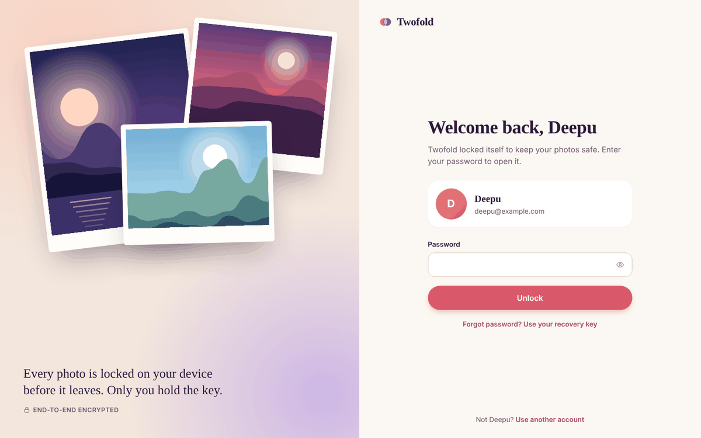
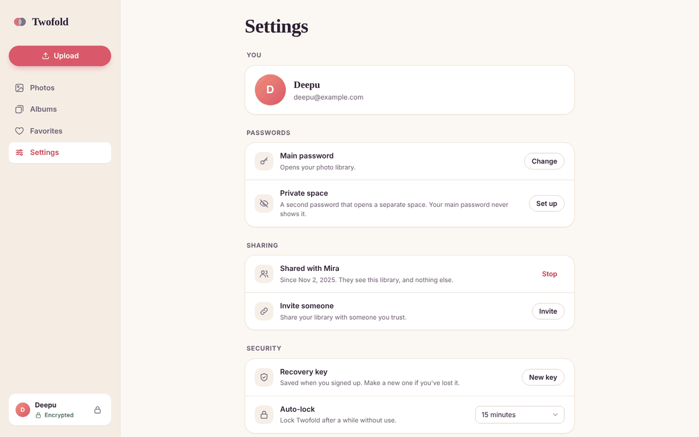
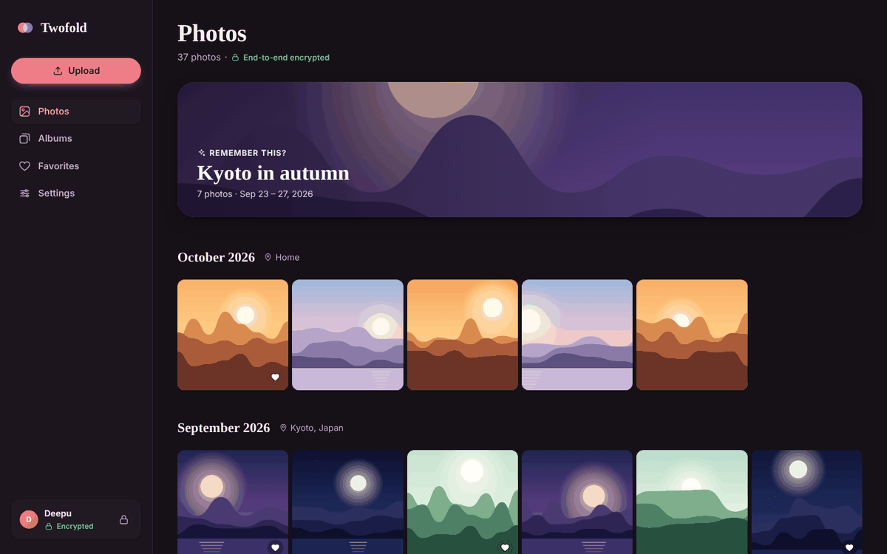
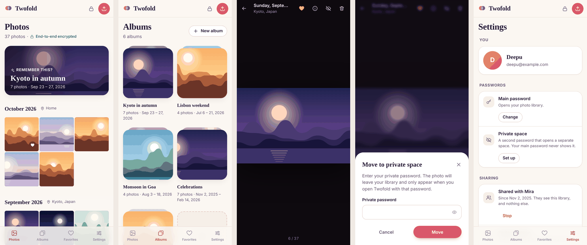

# Web UI

Every screen of the web app exists today on **mock data**: nothing calls the API or
`packages/crypto` yet. Mock content lives in `apps/web/src/mock/` (placeholder landscape
"photos" are drawn as SVG data URIs) and app state is in memory only.

Twofold presents itself as a private, end-to-end encrypted photo library for anyone. Sharing
exists but is low-key (Settings → Sharing).

## Two passwords, two spaces

- The **main password** opens the main library: everyday uploads and backups.
- An optional **private password** opens a separate **private space** with its own photos
  and albums. It is set up from Settings → Passwords.
- Log in and Unlock have a single password box; the password typed decides which space
  opens. Nothing on those screens differs between the two.
- The main library never reveals whether a private space exists: Settings always offers
  "Set up", and the move dialog gives the same answer for a wrong password and for no
  private space.
- Inside the private space the app is re-tinted violet (`data-space="private"` on `<html>`,
  tokens in `styles/base.css`) and shows a small "Private" label, so you know where you are.
- **Move to private space** (photo viewer, main library) asks for the private password.
  **Move to library** (private space) moves a photo back. Albums belong to one space, so a
  moved photo arrives unfiled.
- Each space is shared separately (Settings → Sharing → Invite). Sharing the library never
  shares the private space.
- The lock button (sidebar, or top bar on phones) forgets which space was open.

Mock behaviour: any password opens the main library; `private1234` opens the private space
until a new private password is chosen in Settings. For real, unlocking will try the
password against each key slot in `packages/crypto`, and the server must not be able to
tell how many spaces an account has. That design is still open (see
[security.md](security.md)).

## Screens and routes

Routes are the same in both spaces; the content depends on which space is open.

| Route                  | Screen                                                          |
| ---------------------- | --------------------------------------------------------------- |
| `/`                    | Welcome                                                         |
| `/signup`              | Create your account (step 1 of 2)                               |
| `/signup/recovery-key` | Save your 12-word recovery key (step 2)                         |
| `/login`               | Log in                                                          |
| `/unlock`              | Unlock (returning user, key not in memory)                      |
| `/recover`             | Reset the password with the recovery key                        |
| `/photos`              | Library or private space: timeline grouped by month             |
| `/photos/:id`          | Photo viewer; `?from=favorites` or `?from=album:<id>` scopes it |
| `/albums`              | Albums, with "New album"                                        |
| `/albums/:id`          | One album                                                       |
| `/favorites`           | Favorites                                                       |
| `/settings`            | Profile, passwords, sharing, security, devices, appearance      |
| `/settings/share`      | Invite someone to the open space, or join with a code           |
| anything else          | Not found                                                       |

Upload is a dialog opened from the sidebar (desktop) or the top bar (phones); inside an
album it also adds the photos to that album. Its "encrypting" progress is simulated.

## Structure (`apps/web/src`)

- `app/` — routing (`routes.ts` parses URLs, `router.tsx` is a small History API router
  with no dependency), and in-memory state: vault (both spaces), theme, toasts.
- `components/` — layout (`AppShell`, `AuthLayout`) and shared pieces (fields, dialog,
  photo grid, upload dialog, icons, logo).
- `screens/` — one file per screen, each with its own stylesheet.
- `styles/base.css` — design tokens, light and dark themes, the private-space tint, buttons
  and forms.

## Visual language

- Warm ivory with a rose-coral accent in light mode, deep plum in dark mode; cooler violet
  in the private space. The theme follows the device; Settings can force light or dark
  (kept in memory only).
- Serif headings (system serif stack) over a system sans body. No web fonts, so the CSP's
  `default-src 'self'` needs no exceptions.
- Plain CSS with custom properties; no CSS-in-JS and no `<style>` injection, so
  `style-src 'self'` holds. The only inline style is the upload progress width, set
  through the CSSOM, which the CSP allows.
- Layout switches at 860px: sidebar on wide screens, top bar plus bottom tabs on phones.

## Security notes for when real data arrives

- Decrypted photos are shown through in-memory object URLs (as uploads already are) and
  must never be written to `localStorage`, IndexedDB or caches.
- The mock keeps the private password in React state so the demo works. Real code keeps
  no password anywhere.
- The recovery key, invite code and devices shown today are placeholders; real values
  come from `packages/crypto` and the API.

## Screenshots

| Desktop                                                        | Desktop                                                       |
| -------------------------------------------------------------- | ------------------------------------------------------------- |
|                     |                     |
|                       |                      |
|                         |                      |
|                    |                  |
|                         |             |
|       |  |
|  |                                                               |

Phones:

