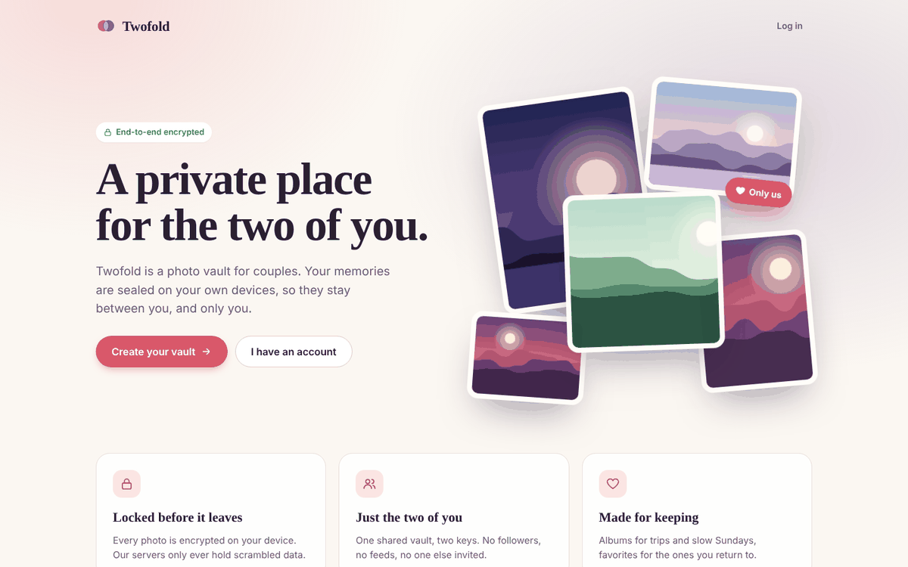
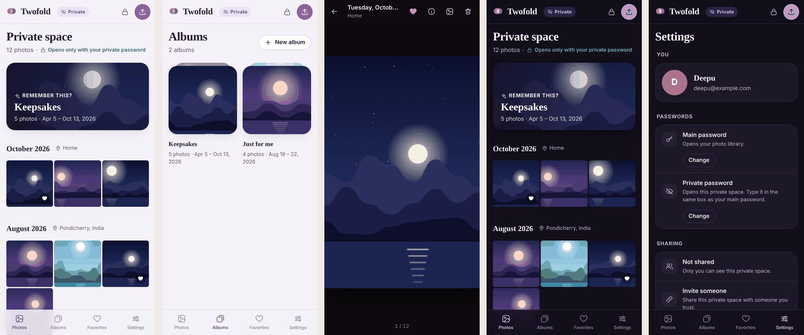

# Web UI

Accounts and photo storage are real: sign-up, log in, unlock, recovery and both passwords
call the API and `packages/crypto`, and photos, favorites and albums are stored end-to-end
encrypted in each space (design in [security.md](security.md)). Unlocking downloads and
decrypts the open space; locking or reloading drops everything decrypted. The mock library in `apps/web/src/mock/` (placeholder landscape
"photos" drawn as SVG data URIs) now only decorates the welcome and sign-in screens and
feeds unit tests. Sharing and invite codes are real too, and so is auto-lock.

Twofold presents itself as a private, end-to-end encrypted photo library for anyone. Sharing
exists but is low-key (Settings → Sharing).

## Two passwords, two spaces

- The **main password** opens the main library: everyday uploads and backups.
- An optional **private password** opens a separate **private space** with its own photos
  and albums. It is set up from Settings → Passwords.
- Log in and Unlock have a single password box; the password typed decides which space
  opens. Nothing on those screens differs between the two.
- The main library never reveals whether a private space exists: Settings always offers
  "Set up", and the move dialog gives the same answer for a wrong password and for no
  private space.
- Inside the private space the app is re-tinted violet (`data-space="private"` on `<html>`,
  tokens in `styles/base.css`) and shows a small "Private" label, so you know where you are.
- **Move to private space** (photo viewer, main library) asks for the private password the
  first time after unlocking, then moves straight in until Twofold locks. Right after
  setting up a private space it doesn't ask at all.
  **Move to library** (private space) works the same way with the main password. Albums
  belong to one space, so a moved photo arrives unfiled. A move re-encrypts the photo
  under a new key and id in the other space, then deletes the original.
- Each space is shared separately (Settings → Sharing → Invite). Sharing the library never
  shares the private space. The Share screen gives a link (**Copy link**, and **Share link**
  where the browser can share) and a code to type under "I have a code" instead. They can
  accept any time in the next 7 days; leaving the screen doesn't cancel anything. Invites
  still waiting are listed on the Share screen and in the album's people list, with
  **Cancel**.
- Opening a link (`/join/<token>`) asks to sign in, sign up or unlock first, then comes back
  to it. It doesn't say who sent it until they reveal it: **Accept** sends this side's key,
  and the page says what's happening next, with **Don't join**. Either person can leave at
  any point; each step is taken the next time their side opens Twofold (on load, when the
  app comes back into view, and every few seconds while someone is partway through).
- When someone has accepted, the inviter sees "<name> wants to join <your library or the
  album>. Check these 4 words with them" at the top of every screen of that space, on any of
  their devices, with **They match, share** and **Cancel**. The person joining sees the same
  four words and "Waiting for <name> to confirm". Nothing is shared until the inviter
  confirms; what was shared turns up on the joiner's next visit.
- A library you join appears inside the space you joined it from, mixed in with your own
  photos. Its albums appear too, and photos uploaded into one of them go to that library
  under your name. Photos from a joined library can be favorited or deleted for everyone,
  but not moved to the other space. Settings lists who the open space is shared with (with
  **Stop**) and the libraries it joined (with **Leave**).
- One album can be shared instead of a whole library: **Share** in an album's menu lists
  who has access (with **Remove**, and **Stop sharing with everyone**) and offers **Invite
  someone**, which opens the same invite screen for just that album
  (`/settings/share?album=<id>`). The other person joins with the link or code as usual. They can
  view and download the album's photos, including ones added later, and leave it from its
  menu; they can't change anything, and its photos stay out of their timeline and
  favorites.
- The lock button (sidebar, or top bar on phones) forgets which space was open.

## Selecting photos and album actions

- Every photo grid (timeline, album, favorites) lets photos be picked. With a mouse, each
  tile shows a check in its corner on hover; on touch screens, **Select** in the page header
  starts picking, and then a tap selects instead of opening. Each month in the timeline has
  **Select all** for that month, and the selection bar has **Select all** for the page.
  Escape or the × stops picking.
- The selection bar sits over the top of the page: **Add to album** (pick an album, or make
  one and add to it), **Remove from album** (inside an album), **Share**, **Download**,
  **Add to favorites** / **Remove from favorites**, **Move to private space** / **Move to
  library**, and **Delete**. Photos from an album shared with you only offer **Download**. Changes run a few photos at a time; afterwards only the photos that
  didn't go through stay selected, and a toast says how many did.
- Moving a selection asks for the other space's password exactly as moving one photo does
  (once per unlock, same answer for a wrong password as for no private space). Photos from
  a library shared with you are left out of a move, and can only go in that library's
  albums: the album picker only offers albums at least one selected photo can go in.
- **Share** means sharing with people inside Twofold, always through an album: inside one of
  your albums it opens the invite for that album; elsewhere it asks which of your albums to
  put the photos in (albums already shared come first, or make a new one), then opens that
  album's invite. Everyone invited to an album sees the same album, so sharing with more
  people never makes copies.
- **Download** saves copies to the device. It downloads and decrypts the originals four at
  a time (up to 1 GB in all) and shows "Downloading 12 of 19" with a progress bar; then the
  button saves them. One photo is saved as it is. Several download as one zip
  (`Twofold <yyyy-mm-dd>.zip`, stored without compression), except on a touch device that
  can share files, where **Save to device** opens the share sheet so they can go straight
  to the photo gallery. Copies are named by when they were taken (`2026-10-19 14.32.05.jpg`,
  with ` (2)` for photos from the same second), never after the space or album. The
  dialog says downloaded copies aren't encrypted.
- Every album has a vertical "more" menu, always visible on its card in Albums and next to
  **Select** inside it. Your albums: **Share**, **Download**, **Rename** and **Delete
  album** (deleting keeps the photos). Albums of a library shared with you: **Download**,
  **Rename** and **Delete album**. An album shared with you: **Download** and **Leave
  album**. Inside an album there is also a **Download** button.
- Albums has three tabs: **All albums**, **Shared with me** (other people's albums, shared
  alone or with their library) and **Shared by me** (your albums shared with at least one
  person). Cards say who an album is from or shared with.
- Code: `app/selection.ts` (selection state), `components/SelectionBar.tsx`,
  `AlbumPicker.tsx`, `DownloadDialog.tsx`, `AlbumActions.tsx`, `AlbumShareDialog.tsx`,
  `MoveSpaceDialog.tsx` (shared with the viewer), and the vault's batch changes in
  `app/vault.tsx`.

Unlocking tries the password against every key slot on the device (see
[security.md](security.md#key-slots)), so the server never learns which space opened.
Setting up a private space from the main library always looks the same and replaces any
private space that already exists, since the main library can't know whether there is one.

## Accounts and locking

- Signed out: only the welcome, sign-up, log-in and recovery screens are reachable; library
  routes redirect to `/login`.
- Signed in but locked (after a reload, or the lock button): library routes redirect to
  `/unlock`, which greets the account by name. Keys are only ever in memory, so a reload
  always locks.
- Sign-up makes the keys and the recovery key at step 1 (Argon2id runs on the device, so
  the button shows "Creating your keys…"), shows the 12 words at step 2, and only then
  creates the account.
- `/signup/recovery-key` doubles as "New key" from Settings in the main library. The private
  space can't make a recovery key; its Settings say the private password can't be recovered.
- Password hashing runs in a Web Worker, so spinners keep moving and the page stays usable
  while a login or unlock works. Signing out in the meantime ("Use another account")
  cancels it: the library doesn't open afterwards.
- Auto-lock (Settings) locks after 1, 5 or 15 minutes without use (default 15), or only
  when the tab closes. Pointer, key, wheel, touch and scroll count as use; a hidden tab gets
  none, so its time counts as idle, and the check runs again when the tab is shown. Uploads
  in progress count as use, so a long upload isn't dropped, and the countdown restarts when
  they finish. The choice is a per-browser preference in localStorage
  (`twofold.autoLockMinutes`); nothing secret is stored with it. Logic in
  `lib/idle-timer.ts` and `app/auto-lock.tsx`.
- Delete account asks for a password.
- Settings → You → Edit changes the name (shared by both spaces) and the profile photo
  (one per space, so the private space starts with initials). The photo is cropped to a
  square on the device and encrypted before upload (`app/profile.tsx`,
  `app/profile-photo.ts`, `components/ProfileDialog.tsx`).
- Storage used shows in Settings → Storage and at the bottom of the sidebar. The main
  library shows "12.4 MB of 1 GB used here", counting only its own photos, so it can't hint
  at a private space. The private space shows "19.1 MB of 1 GB used in total": both spaces,
  against the one shared 1 GB (`app/storage.tsx`, `lib/storage-usage.ts`).
- State lives in `app/account.tsx` (who is signed in, which slot is open) and
  `app/account-ops.ts` (every operation that touches keys); `app/access.ts` decides
  redirects.

## Screens and routes

Routes are the same in both spaces; the content depends on which space is open.

| Route                  | Screen                                                             |
| ---------------------- | ------------------------------------------------------------------ |
| `/`                    | Welcome                                                            |
| `/signup`              | Create your account (step 1 of 2)                                  |
| `/signup/recovery-key` | Save your 12-word recovery key (step 2)                            |
| `/login`               | Log in                                                             |
| `/unlock`              | Unlock (returning user, key not in memory)                         |
| `/recover`             | Reset the password with the recovery key                           |
| `/photos`              | Library or private space: timeline grouped by month                |
| `/photos/:id`          | Photo viewer; `?from=favorites` or `?from=album:<id>` scopes it    |
| `/albums`              | Albums, with tabs and "New album"                                  |
| `/albums/:id`          | One album, with Download and its menu                              |
| `/favorites`           | Favorites                                                          |
| `/settings`            | Profile, passwords, sharing, security, devices, appearance         |
| `/settings/share`      | Invite someone to the open space (or `?album=` one album), or join |
| `/join/:token`         | Someone's invite link: accept it                                   |
| anything else          | Not found                                                          |

Upload is a dialog opened from the sidebar (desktop) or the top bar (phones); inside an
album it also adds the photos to that album. Each photo is read on the device, given a
640px JPEG preview (`lib/thumbnail.ts`), encrypted, then uploaded; the progress bar
follows those steps. Up to three photos go at once, in the order they were added, so each
one's server round trips overlap the others'. Big photos go fewer at a time: at most 48 MB
of originals are in flight, and a photo bigger than that goes alone (`lib/upload-queue.ts`),
which keeps memory in check on phones. The upload list shows that small preview once a photo
has been read, never the original, so dropping hundreds of photos stays light.

Uploads don't belong to the dialog: the queue (`app/uploader.ts`, provided by
`app/uploads.tsx`) lives as long as the open vault, so closing the dialog (the X, Close, a
click outside, Escape), moving around the app or switching browser tabs leaves photos
uploading. While they run with the dialog closed, a small card (bottom right on desktop,
under the top bar on phones) shows "3 of 6 photos uploaded" with an overall progress bar,
and clicking it reopens the list. "Cancel remaining" drops photos that haven't started.
Closing or reloading the tab can't keep uploading, so the browser asks before leaving while
uploads run; locking drops the queue with the vault. When everything has finished with the
dialog closed, the list starts over, unless a photo failed: then the card stays, saying how
many couldn't upload, until the list has been opened.

The grid shows a quiet placeholder until a photo's preview has been downloaded and
decrypted. Previews are only asked for once their photo is near the screen (within about
two phone screens, `lib/near-screen.ts`), and are downloaded up to 48 per request.
Photos already on the screen go first, 12 per request, so they don't wait behind the ones
below the fold. Each preview is decrypted as soon as its bytes arrive, without waiting for
the rest of its request. When the vault opens, your own library, every library or album
shared with you, and who your albums are shared with are all fetched at the same time.
Decrypted previews reach the grid in batches, at most every 100 ms, so a large library
redraws a few times a second rather than once per photo. A request that fails is tried
again after 1, 2 and 4 seconds (`app/thumb-loader.ts`), so a dropped connection doesn't
leave tiles empty. The viewer then fetches and
decrypts the original.

The photo viewer zooms with the mouse wheel or a trackpad pinch (towards the pointer),
a two-finger pinch on touch screens, a double-click (toggles 2.5×), and the `+`, `-` and
`0` keys. A zoomed photo pans by dragging; a fitted one swipes to the next photo. After
each zoom change the level (as a percentage of the fitted size) shows at the top of the
photo for a moment, then fades. The maths is in `lib/zoom.ts`, the gestures in `screens/use-zoom.ts`.

## Structure (`apps/web/src`)

- `app/` — routing (`routes.ts` parses URLs, `router.tsx` is a small History API router
  with no dependency), and in-memory state: vault (the open space), theme, toasts.
  `space-store.ts` reads and writes one space's encrypted photos and albums through the
  API.
- `components/` — layout (`AppShell`, `AuthLayout`) and shared pieces (fields, dialog,
  photo grid, upload dialog, icons, logo).
- `screens/` — one file per screen, each with its own stylesheet.
- `styles/base.css` — design tokens, light and dark themes, the private-space tint, buttons
  and forms.

## Visual language

- Warm ivory with a rose-coral accent in light mode, deep plum in dark mode; cooler violet
  in the private space. The theme follows the device; Settings can force light or dark
  (kept in memory only).
- Serif headings (system serif stack) over a system sans body. No web fonts, so the CSP's
  `default-src 'self'` needs no exceptions.
- Plain CSS with custom properties; no CSS-in-JS and no `<style>` injection, so
  `style-src 'self'` holds. The only inline style is the upload progress width, set
  through the CSSOM, which the CSP allows.
- Layout switches at 860px: sidebar on wide screens, top bar plus bottom tabs on phones.

## Security notes

- Decrypted photos are shown through in-memory object URLs, revoked when the vault
  unmounts (lock, sign-out), and must never be written to `localStorage`, IndexedDB or
  caches.
- No password is kept anywhere: it is turned into keys inside `app/account-ops.ts` and
  dropped. Keys live only in React state and are dropped on lock, sign-out and reload,
  along with every decrypted photo (the vault provider is remounted).

## Screenshots

| Desktop                                                        | Desktop                                                       |
| -------------------------------------------------------------- | ------------------------------------------------------------- |
|                     |                     |
|                       |                      |
|                         |                      |
|                    |                  |
|                         |             |
|       |  |
|  |                                                               |

Phones:

