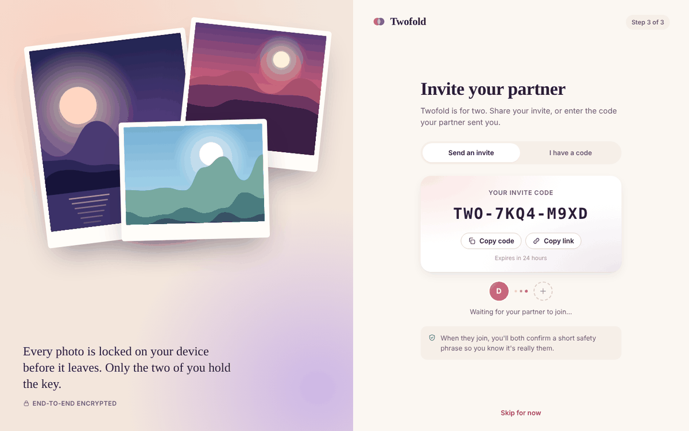
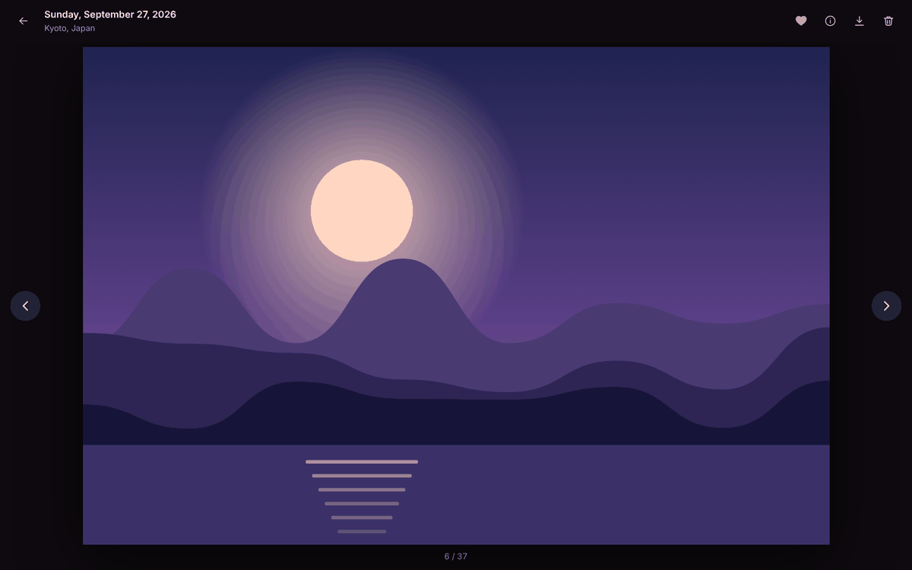
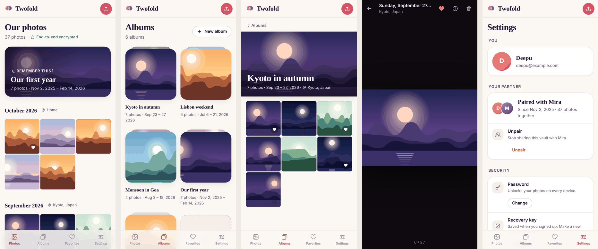
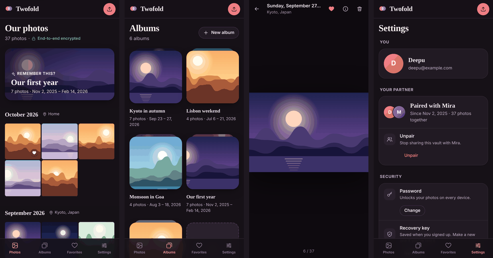

# Web UI

Every screen of the web app exists today on **mock data**: nothing calls the API or
`packages/crypto` yet. Mock content lives in `apps/web/src/mock/` (placeholder landscape
"photos" are drawn as SVG data URIs) and app state is in memory only.

## Screens and routes

| Route                  | Screen                                                          |
| ---------------------- | --------------------------------------------------------------- |
| `/`                    | Welcome                                                         |
| `/signup`              | Create your vault (step 1 of 3)                                 |
| `/signup/recovery-key` | Save your 12-word recovery key (step 2)                         |
| `/pair`                | Invite your partner or join with a code (step 3)                |
| `/login`               | Log in                                                          |
| `/unlock`              | Unlock a locked vault (returning user, key not in memory)       |
| `/recover`             | Reset the password with the recovery key                        |
| `/photos`              | Gallery: timeline grouped by month                              |
| `/photos/:id`          | Photo viewer; `?from=favorites` or `?from=album:<id>` scopes it |
| `/albums`              | Albums, with "New album"                                        |
| `/albums/:id`          | One album                                                       |
| `/favorites`           | Favorites                                                       |
| `/settings`            | Profile, partner, security, devices, appearance                 |
| anything else          | Not found                                                       |

Upload is a dialog opened from the sidebar (desktop) or the top bar (phones); inside an
album it also adds the photos to that album. Its "encrypting" progress is simulated.

## Structure (`apps/web/src`)

- `app/` — routing (`routes.ts` parses URLs, `router.tsx` is a small History API router
  with no dependency), and in-memory state: vault (photos, albums), theme, toasts.
- `components/` — layout (`AppShell`, `AuthLayout`) and shared pieces (fields, dialog,
  photo grid, upload dialog, icons, logo).
- `screens/` — one file per screen, each with its own stylesheet.
- `styles/base.css` — design tokens, light and dark themes, buttons and forms.

## Visual language

- Warm ivory with a rose-coral accent in light mode, deep plum in dark mode. The theme
  follows the device; Settings can force light or dark (kept in memory only).
- Serif headings (system serif stack) over a system sans body. No web fonts, so the CSP's
  `default-src 'self'` needs no exceptions.
- Plain CSS with custom properties; no CSS-in-JS and no `<style>` injection, so
  `style-src 'self'` holds. The only inline style is the upload progress width, set
  through the CSSOM, which the CSP allows.
- Layout switches at 860px: sidebar on wide screens, top bar plus bottom tabs on phones.

## Security notes for when real data arrives

- Decrypted photos are shown through in-memory object URLs (as uploads already are) and
  must never be written to `localStorage`, IndexedDB or caches.
- The recovery key, invite code and devices shown today are placeholders; real values
  come from `packages/crypto` and the API.

## Screenshots

| Desktop                                       | Desktop                                            |
| --------------------------------------------- | -------------------------------------------------- |
|    |          |
|          |           |
|        |           |
|  |  |

Phones:

